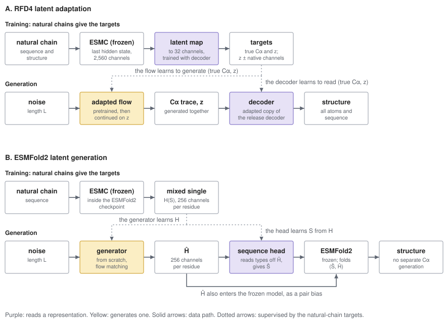

# Foldspace

**Exploring ESMC-derived latent spaces for protein sequence–structure generation.**

Motivated by the strong MSA-free structure prediction of ESMFold2 and by the latent generative architectures of La-Proteina and RFD4-Proteina, Foldspace asks whether pretrained ESMC representations can be the basis of a protein design model. It investigates two architectures.

## Approaches

**RFD4 latent adaptation.** Adapting the pretrained decoder and flow of RFD4-Proteina to ESMC-derived latents, through partial channel replacement and complete latent replacement, with an explicit Cα trace generated beside the latent.

**ESMFold2 latent generation.** Generating mixed-single representations directly, recovering their sequences, and folding both with frozen ESMFold2 without separately generating Cα coordinates.



## Findings

High reconstruction or sequence-decoding accuracy did not, by itself, establish successful generation in the corresponding representation space.

- **RFD4 latent adaptation:** ESMC-derived latents reached 99.85 % residue-type recovery and 0.707 Å reconstruction RMSD given the true Cα trace, but did not support reliable generation.
- **Hybrid latents:** ESMC contextual information showed no reproducible advantage over type-shuffled controls.
- **ESMFold2 latent generation:** Natural mixed singles supported 99.12 % sequence recovery, while none of the 192 generated samples passed the computational success criteria.

[Results](docs/results.md) · [Methods](docs/methods.md) · [Related work](docs/related_work.md)

## Infrastructure

Foldspace uses [esmfold2-atomworks](https://github.com/daylight-00/esmfold2-atomworks) for ESMFold2 integration with AtomWorks.

## Reproducibility

Committed experiment records, evaluation code and offline tests support result-level reproducibility. Training and folding require external weights and the pinned GPU environment. A single result can be recomputed on a CPU from the committed per-sample records ([instructions](reproducibility/README.md#recompute-a-result-on-a-cpu)); the tests do this for every ESMFold2 set and check the reported results against the records:

```bash
export PYTHONPATH=src
uv run --no-project --python 3.12 --with pytest --with numpy -- python -m pytest -m offline
```

## Status

Exploratory computational research. Neither architecture achieved reliable unconditional protein generation under the tested configurations, and no experimental validation is claimed. This independent project was developed with extensive use of AI coding and research agents for implementation and experimental execution.

## License

Code is released under the [MIT License](LICENSE). External software and model weights retain their respective licenses. Reference structures are derived from the [PDB archive](https://www.rcsb.org/pages/policies) (CC0).
