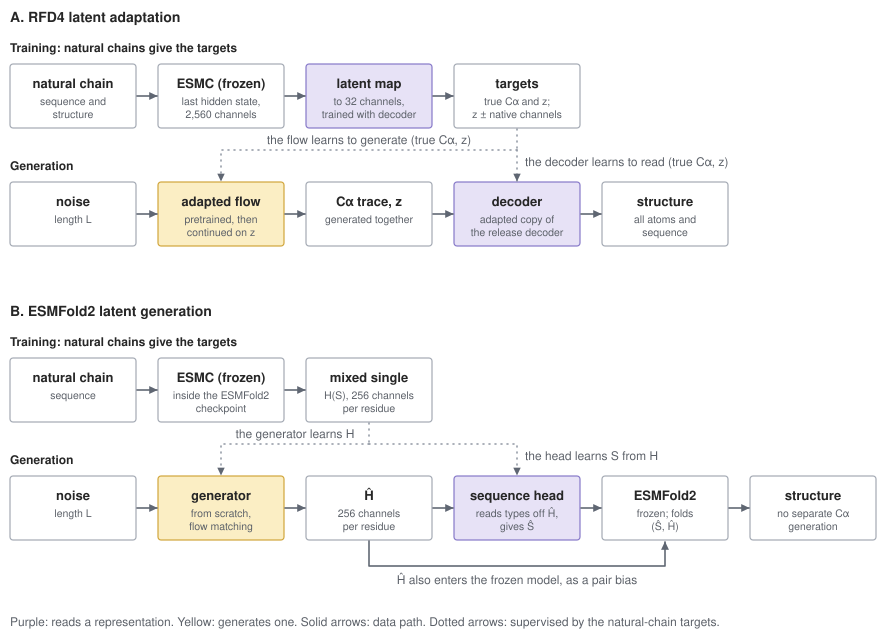

# Methods

*Can a pretrained protein representation serve as the latent of a generative model for joint sequence–structure design?* Two architectures test it, one in the latent of an existing generative model and one in the representation of a folding model. This document defines what was built and how it was measured. Numbers are in [results.md](results.md); seeds, budgets, settings and commands are in [`reproducibility/`](../reproducibility/README.md).

The architectures differ in what supplies the structure. In A, an existing generative model keeps an explicit Cα trace beside the latent, and a decoder adapted to a sequence-derived latent renders atoms from both. In B, the pretrained structure predictor is itself the structure decoder, so no backbone is generated separately and the generated representation has to carry what the folding model needs.

## Architecture A: RFD4 latent adaptation

RFD4-Proteina generates a Cα trace and a 32-channel latent per residue, and its decoder renders atoms and sequence from both. This architecture keeps the Cα trace, rebuilds the latent from ESMC's last hidden state, and adapts the two pretrained networks (decoder, then flow) to it. A reconstruction always takes the true Cα trace as an input, so it measures how well a decoder reads a code beside a given backbone, not how much structure the code carries. Code: `src/foldspace/rfd4/`.

**Evaluation of samples.** Samples are unconditional, 80 to 200 residues. A sample is a *chain* when 99 % of its consecutive Cα distances lie in 3.6 to 4.0 Å, none is above 4.5 Å, and no two Cα more than two residues apart are under 3.0 Å. Its sequence is *not collapsed* when it has at least 15 residue types and none over a quarter of the chain. A sample is *usable* when it is a chain, not collapsed, and its AtlasFold fold lies within 2 Å of its own backbone.

### Latent adaptation

[`experiments/rfd4/latent_adaptation`](../experiments/rfd4/latent_adaptation/README.md)

1. **Reading adapters.** An encoder in front of the frozen release decoder, fed the backbone alone, the residue type, or ESMC's state. The release encoder on all atoms is the upper bound.
2. **Adapted decoder.** The latent maps ESMC's state to 32 channels (all of them, or a split with channels from the release encoder). The decoder is a copy of the release decoder with every parameter trained. Controls replace ESMC's code by a fixed code of the residue types alone. Reconstruction is scored on 256 held-out chains by per-residue RMSD of complete residues and the share of residue types recovered.
3. **Flow adaptation.** The pretrained flow is continued under each latent with one budget for every configuration. It is evaluated by its Cα skill over a predictor that sees only the noisy coordinates, its skill on the code channels over a token-only predictor, and the samples it generates.

| configuration | latent | flow network |
|---|---|---|
| `native_continuation` | the release latent | pretrained, continued |
| `esmc_residual8` | 24 ESMC channels and 8 residual channels from the release encoder | pretrained |
| `esmc_residual8_scratch` | the same | randomly initialized |
| `inplace_hybrid` | 14 native channels kept, 18 ESMC channels | pretrained |
| `type_only_residual8` | a fixed code of the residue types in 24 channels and the 8 residual channels | pretrained |

The residual channels are the release encoder's posterior mean on the same chain; the encoder is absent at generation.

### Hybrid latents

[`experiments/rfd4/hybrid_latents`](../experiments/rfd4/hybrid_latents/README.md)

Of the release latent's 32 channels, 16 carry information its decoder reads and 16 sit near the prior. The hybrid layout keeps 14 of the informative channels from the release encoder and puts a code of the residue in the other 18. The question is whether the code's *context* (what ESMC knows of a residue beyond its type) helps the flow that generates it, so each configuration is compared with controls that keep the layout and change the code.

| configuration | the 18 code channels |
|---|---|
| `native_continuation` | none: the release latent (reference) |
| `contextual_hybrid` | ESMC's code, with the release's posterior noise |
| `type_shuffled_hybrid` | the same code, replaced at every presentation by the code of another residue of the same type: type kept, context removed |
| `native_identity_control` | draws from the release encoder's own per-type distribution of those channels |
| `identity_hybrid` | a fixed code of the residue types |
| `learned_posterior_hybrid` | ESMC's code with a learned posterior width |
| `deterministic_hybrid` | ESMC's code without a posterior |

The type-shuffled control is validated before training against thresholds on held-out context R², type-centroid similarity and within-type variance. `contextual_hybrid` and `type_shuffled_hybrid` were trained at two seeds; the other controls at the first. Every flow starts from the pretrained base checkpoint, and the public release flow is evaluated as a baseline designer.

* **Design panels.** Two panels of 96 backbones generated by the release flow. Each designer proposes one sequence per backbone, AtlasFold folds it, and it is *designable* when the fold lies within 2.0 Å of the backbone. A sequence *passes* when it is designable with at least 3.0 bits of composition entropy. Designers are compared pairwise by backbone, as a net count per 96 with an exact interval. ProteinMPNN is the external baseline.
* **Unconditional generation.** 192 samples at the release's noise scale and at each configuration's tuned scale, and a scan over noise scales, scored as *usable*.

### Latent replacement

[`experiments/rfd4/latent_replacement`](../experiments/rfd4/latent_replacement/README.md)

Nothing of the release latent is kept: every channel is `z = M(W LN(h))`, with `W` mapping ESMC's 2,560 channels to 32, trained jointly with the decoder (a copy of the release decoder, every parameter trained).

* `esmc_only` is this latent, at two seeds.
* `type_only` is the matched control: a fixed random 32-channel vector per residue type, moment-matched to the marginals of `esmc_only`, with its decoder trained the same way.
* The flow starts from the release's pretraining checkpoint and is continued under each latent; the `esmc_only` runs are extended to 2,400 and 3,200 updates. The native continuation is the reference.

Evaluation: latent statistics (variance fixed by residue type, participation ratio, held-out R² of the code from context within types), unconditional generation at each checkpoint, the variance of the generated code along sampling, and the effect of moment-matching generated codes to the natural ones.

## Architecture B: ESMFold2 latent generation

ESMFold2 builds the pair prior of its trunk from a 256-channel per-residue state, the *mixed single* `H(S)`, a learned mixture over the 81 layers of the ESMC stack of sequence `S`. The mixed single enters the model only as a pair bias, and the sequence enters by a second route (the input embedder), so a generated single does not by itself fix a protein. The architecture generates the single, decodes a sequence from it, and folds the pair with the frozen model:

`Ĥ = G(ε)`, `Ŝ = D(Ĥ)`, `X̂ = ESMFold2(Ŝ, Ĥ)`

Code: `src/foldspace/esmfold2/`. Samples are folded on three routes:

| route | input to the folding model | isolates |
|---|---|---|
| reconstructed | `(Ŝ, H(S))` | effect of sequence decoding errors |
| **direct** | `(Ŝ, Ĥ)` | the generative target |
| re-encoded | `(Ŝ, H(Ŝ))` | whether the sequence alone was generated |

### Interface validation

[`experiments/esmfold2/interface_validation`](../experiments/esmfold2/interface_validation/README.md)

* **Target audit** of the cached singles of 17,063 training chains: scale, tails, spectrum, locality.
* **Parity.** One sequence folded through four routes: the model deriving its own stack, a stack computed outside and handed in, the stack's single injected, and the single injected into a model with no ESMC backbone (the path a generator takes). A route passes if it differs from the native route by no more than two native runs differ from each other.
* **Contribution.** For length-matched chains `A` and `B`, `(S_A, H_B)` combines the sequence of one protein with the single of another; it is compared with the position-aware mean single, no language-model prior, and the sampler floor (24 pairs, 48 swaps).

### Sequence decoding

[`experiments/esmfold2/sequence_decoding`](../experiments/esmfold2/sequence_decoding/README.md)

* **Heads.** `linear` (residue-wise classifier), `contextual` (Transformer, 3,246,868 parameters, two training seeds) and `lda` (closed form). Dev and test chains share no 30 % sequence cluster with training; the test split is scored once per model.
* **Structure check.** 24 dev chains folded on four routes: the teacher `(S, H(S))`, reconstructed, re-encoded, and a random twin of the decoded sequence with the same number of substitutions.
* **Robustness.** Five families of error in the standardized single (independent noise, data-shaped noise, shrinkage, projection on leading directions, dropped positions); the chains are folded from the perturbed single, and the heads read the dev split under the same errors.

### Latent generation

[`experiments/esmfold2/latent_generation`](../experiments/esmfold2/latent_generation/README.md)

* **Generator.** A Transformer denoiser trained from scratch by flow matching on the singles of 17,063 training chains (3,373 clusters at 30 % identity), standardized channel by channel. The frozen `contextual` head reads `Ŝ` off `Ĥ`.
* **Configurations**, three over two coordinate systems: `standardized`; `whitened` (the same data rotated onto the training covariance's directions and scaled); and `whitened_with_sequence_loss` (`whitened` plus the cross-entropy of the frozen head on the predicted single). `standardized` is repeated at a second training seed.
* **Controls**, evaluated with the same criteria: `protgpt2`, a published autoregressive generator (738 M parameters); `sequence_only`, a decoder-only Transformer on residues trained on the same corpus (two seeds, two temperatures); and `esmc_unmasking`, ESMC's iterative unmasking.

| pilot scale | |
|---|---|
| training chains, sequence clusters | 17,063, 3,373 |
| generator | 39,025,408 parameters, 256-channel latent, 20,000 updates, 50 Heun steps |
| samples | 3 configurations × 48 (144), and 48 at the second seed |

## Evaluation criteria

* **Refolding** (`foldspace.evaluation.refold`) refolds a sequence with an independent folder (AtlasFold) and scores it against a structure. Both architectures are evaluated through it, so ESMFold2 is never the only judge of what a generator conditioned on it produces.
* **Sequence evaluation** (`foldspace.esmfold2.seqeval`). A sample is a *success* if the folding model's mean pLDDT is at least 0.7 and AtlasFold's refold is self-consistent (scTM 0.5), and *credited* if it is also not degenerate in composition and not a copy of a training chain (MMseqs2). Each set is read beside its *floor* (each sample's composition-matched shuffle) and 24 natural *reference* chains, which check that the folds are intact.

## Code

| experiment | entry points |
|---|---|
| latent adaptation, hybrid latents, latent replacement | `train_autoencoder`, `train_flow`, `sample_flow`, `flow_eval`, `code_bank`, `design_cell`, `esmc_only_audit` |
| interface validation, sequence decoding | `interface`, `validate_interface`, `train_decoder`, `evaluate_decoder`, `evaluate_robustness` |
| latent generation | `generator`, `latent_generation`, `sequence_only`, `seqeval` |

The flow trainer also has options that no reported configuration uses (`flow_adapt`, `flow_align`, `flow_donors`).
