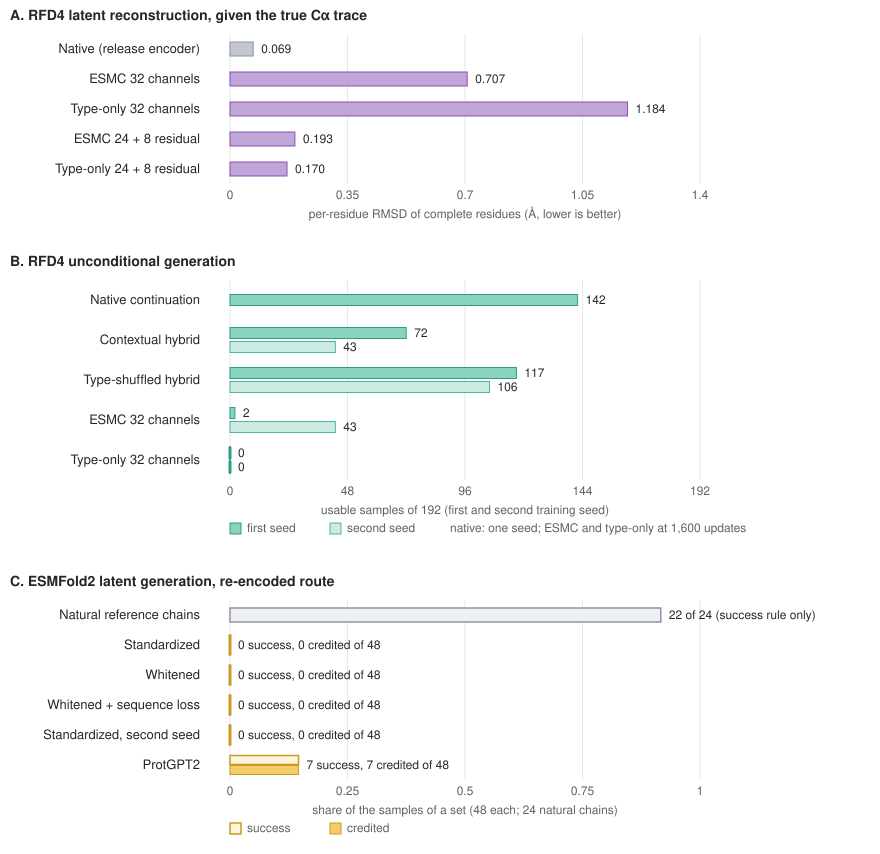

# Results

> High reconstruction or sequence-decoding accuracy did not, by itself, establish successful generation in the corresponding representation space.

Designs and evaluation criteria are in [methods.md](methods.md). Each experiment gives observed numbers, which the tests check against the committed records (`tests/test_results_rfd4.py`, `tests/test_results_esmfold2.py`), followed by an interpretation, which is not tested. Record files are listed in each experiment's README.

*A: reconstruction given the true Cα trace; the 32-channel type-only value is the mean of the two decoders the flows used. B: usable samples of 192. C: samples of the re-encoded route that pass the success rule (outlined) and the credit rule (filled). The sample counts of B and C are defined differently and are not comparable.*

## Architecture A: RFD4 latent adaptation

### Latent adaptation

[`experiments/rfd4/latent_adaptation`](../experiments/rfd4/latent_adaptation/README.md)

Reconstruction of 256 held-out chains, given the true Cα trace:

| latent | RMSD (Å) | residue types recovered |
|---|---|---|
| release encoder, all atoms (upper bound) | 0.069 | |
| ESMC 32D, two seeds | 0.712, 0.702 | 99.84 %, 99.86 % |
| type-only 32D | 1.183 | 100 % |
| ESMC 28D + 4 residual | 0.292 | 99.94 % |
| ESMC 24D + 8 residual | 0.193 | 99.97 % |
| type-only 24D + 8 residual | 0.170 | 100 % |
| 14 native + 18 ESMC | 0.198 | 99.95 % |
| 14 native + 18 ESMC, code channels empty | 0.357 | 79.5 % |

Reading adapters in front of the frozen release decoder reach 1.116 Å (backbone only), 1.322 Å (residue type) and 1.229 Å (ESMC), recovering 0.048, 0.721 and 0.576 of the residue types.

Flow continued under each latent (one budget; a sample passes when it is a chain with a non-collapsed sequence):

| configuration | passing, 800 updates (of 32) | passing, 1,600 updates (of 96) |
|---|---|---|
| `native_continuation` | 28 (0.875) | |
| `esmc_residual8` | 2 | 1 |
| `esmc_residual8_scratch` (randomly initialized flow) | 0 | |
| `inplace_hybrid` | 6 | 13 |
| `type_only_residual8` | 0 | 0 |

Only the native continuation is feasible. After 800 updates the Cα skill of every pretrained configuration is within 0.05 of the native continuation's at noise levels of 0.3 or more (the randomly initialized flow reaches 0.78 against 0.97 to 0.99 at 0.5), and the decoded sequences of the three retargeted configurations concentrate in alanine, glutamate and valine (0.42 to 0.56 of residues against 0.27).

**Interpretation.** The decoder reads the new latents and the pretrained flow's backbone prior carries over, but the flow's generation of the code does not follow in this recipe, and the passing share does not rise from 800 to 1,600 updates. The ESMC-derived latent reduced reconstruction RMSD by 0.48 Å relative to the type-only baseline under the evaluated training setup. The two decoders were trained to read different latents, so this is not an isolated effect of context, and with residual channels a type code reconstructs as well.

### Hybrid latents

[`experiments/rfd4/hybrid_latents`](../experiments/rfd4/hybrid_latents/README.md)

Sequences that pass (designable with at least 3.0 bits of composition entropy) of 96 backbones, designable in brackets:

| designer | primary panel | replication panel |
|---|---|---|
| `native_continuation` | 44 (74) | 48 (74) |
| `native_identity_control` | 41 (79) | 44 (71) |
| `contextual_hybrid`, seed 1 | 65 (80) | 57 (71) |
| `type_shuffled_hybrid`, seed 1 | 54 (79) | 53 (71) |
| `contextual_hybrid`, seed 2 | 44 (67) | 41 (68) |
| `type_shuffled_hybrid`, seed 2 | 63 (71) | 60 (69) |
| ProteinMPNN | 59 (81) | 54 (75) |

Net of `contextual_hybrid` over `type_shuffled_hybrid` per 96 (exact 95 % interval):

| seed | primary panel | replication panel |
|---|---|---|
| 1 | +11 (2.2 to 15.7) | +4 (−6.0 to 12.9) |
| 2 | −19 (−24.7 to −8.8) | −19 (−25.6 to −8.3) |

Pooled over seed 1 on the primary panel and seed 2 on the replication panel the net is −8 (−21.2 to 6.2; exact p 0.30). The control passed its validation before training (held-out context R² −0.004 against a limit of 0.01). Unconditional generation, usable samples of 192 at the release's noise scale:

| `native_continuation` | `native_identity_control` | `contextual_hybrid`, seeds 1 / 2 | `type_shuffled_hybrid`, seeds 1 / 2 |
|---|---|---|---|
| 142 | 133 | 72 / 43 | 117 / 106 |

**Interpretation.** The contextual advantage reversed between training seeds and was absent in unconditional generation, where the contextual hybrid is below its control and the native continuation in both seeds. The experiments therefore give no reproducible evidence that ESMC's context improves the hybrid latent, and no consistent harm on design. The type-shuffled control removes the code's dependence on everything at its residue, not only its sequence context, and keeps ESMC's code, so a contextual lead would not have shown that ESMC's pretraining is needed.

### Latent replacement

[`experiments/rfd4/latent_replacement`](../experiments/rfd4/latent_replacement/README.md)

| latent (seed) | decoder RMSD (Å) | usable of 192 at 1,600 / 2,400 / 3,200 updates |
|---|---|---|
| ESMC 32D (1) | 0.712 | 2 / 11 / 0 |
| ESMC 32D (2) | 0.702 | 43 / 17 / 1 |
| type-only 32D (1) | 1.202 | 0 |
| type-only 32D (2) | 1.166 | 0 |
| native continuation | | 142 |

The decoders reach 99.84 % and 99.86 % of the types (ESMC) and 100 % (type-only). The held-out context R² of the code within residue types is 0.349 and 0.336 for ESMC against 0.011 for the native latent; the type-only code has none. The generated ESMC code loses variance with training (final-state variance 13.5 at 1,600 updates and 2.3 at 3,200 in seed 2, against 33.7 for natural codes), while the native continuation reproduces its own. Moment-matching the generated codes to the natural mean and covariance (3,200 updates, seed 2) raises the samples passing the sequence rule from 1 to 114 of 192, but designable samples only from 4 to 6 and usable from 1 to 3.

**Interpretation.** Neither latent was reliably generated under the tested training recipe, and more updates do not raise generation. The generated code collapses along sampling, and restoring its moments restores the composition of the sequences but not their fit to the backbones. Because the type-only control also fails, the failure under this recipe is not specific to ESMC's information. A flow built for this latent, from the start or at a larger scale, was not tried.

## Architecture B: ESMFold2 latent generation

### Interface validation

[`experiments/esmfold2/interface_validation`](../experiments/esmfold2/interface_validation/README.md)

The singles of the 17,063 training chains have channel standard deviations of 8.22 to 25.85 with no dead channel, |skewness| at most 0.254, and 78 directions holding 90 % of the covariance. Injecting the single reproduces the model's own fold within tolerance on two cards in deterministic mode. Of 48 sequence–single swaps (TM ≥ 0.5), 23 follow the single's protein, 3 keep the sequence's fold and 22 do neither.

**Interpretation.** The mixed single substantially influences folding, but mismatched sequence–single pairs do not reliably produce either reference fold. A route that supplies the right single with a changed sequence is therefore weakly sensitive to the sequence, and the re-encoded route is the one that tests the sequence.

### Sequence decoding

[`experiments/esmfold2/sequence_decoding`](../experiments/esmfold2/sequence_decoding/README.md)

Test accuracy of residue types read off natural singles, cluster-weighted, on 298,386 residues of 1,578 chains in 400 clusters the heads never saw:

| head | test | dev |
|---|---|---|
| `contextual` (3.25 M parameters), two seeds | **0.9912** | 0.9909, 0.9913 |
| `linear` | 0.9850 | 0.9844 |
| `lda` | 0.9750 | |

A decoded sequence folds like the original: the re-encoded fold keeps the teacher's fold on all 20 stable chains (median TM 0.9989; 0.9977 for decoded sequences with errors, against 0.9961 for random twins). The fold also tolerates perturbations the head cannot read through: at least 19 of 20 chains keep their fold in each of 18 standard conditions, while head accuracy falls from 0.987 at noise 0.1 to 0.467 at 0.8. The fold breaks only at the extremes (the mean single at every position, 90 % of positions dropped, projection on one or two directions).

**Interpretation.** High accuracy on natural singles shows that the sequence is in the single, not that a single made by a generator carries it. In these perturbation experiments, which start from natural sequences, a generated single may be too poor to read and still be folded. Whether a generator that gets the sequence right would suffice was not tested.

### Latent generation

[`experiments/esmfold2/latent_generation`](../experiments/esmfold2/latent_generation/README.md)

Samples of 48 per set; results are identical on the direct and re-encoded routes:

| set | success | credited |
|---|---|---|
| `standardized`, `whitened`, `whitened_with_sequence_loss` | 0 of 144 | 0 |
| `standardized`, second training seed | 0 of 48 | 0 |
| `sequence_only`, four sets | 0 in each | 0 |
| `protgpt2` | 7 | 7 |
| `esmc_unmasking` | 23 | 0 (all degenerate) |
| shuffled floors | 0 | |
| natural reference chains | 22 of 24 | |

In the direct fold no sample of `standardized` or `whitened` reaches model pLDDT 0.7 (medians 0.47 and 0.46); `whitened_with_sequence_loss` has one, with self-consistency below 0.5. The median relative L2 distance of a generated single from the single derived from its own sequence is 1.35 to 1.37 across the configurations, against 1.49 to 1.51 for an unrelated sample and 0.045 for natural chains. The frozen head reads the derived single of a generated sequence at median accuracy 1.0.

**Interpretation.** No configuration produced a passing protein, and a sequence-only model of the same size, trained on the same 17,063 chains, passes none either, so sequence generation is not achieved at this scale with or without the single. Consistency between a generated single and its sequence is not achieved either: the generated single lies closer to the unrelated-sample distance than to the natural chains'. The pilot does not separate these two shortfalls and does not show what a larger generator of the mixed single would do.

## Caveats

* Two training seeds are too few to characterise the spread between seeds. The pilot generator (39 M parameters, 17,063 chains) does not distinguish insufficient training data or compute from limitations of the chosen latent representation, and with 48 sequences per set the intervals are wide.
* The hybrid comparisons stand on the pretrained base flow; the public release is evaluated alongside as a baseline designer.
* The pilot does not show whether omitting a Cα trace is viable, and nothing here shows that ESMC's latent cannot be generated.
* The tests compare the stored evaluation results with the numbers above, and for ESMFold2 also recompute each set's summary from its per-sample records. No GPU run, checkpoint evaluation or training was repeated for this release.
